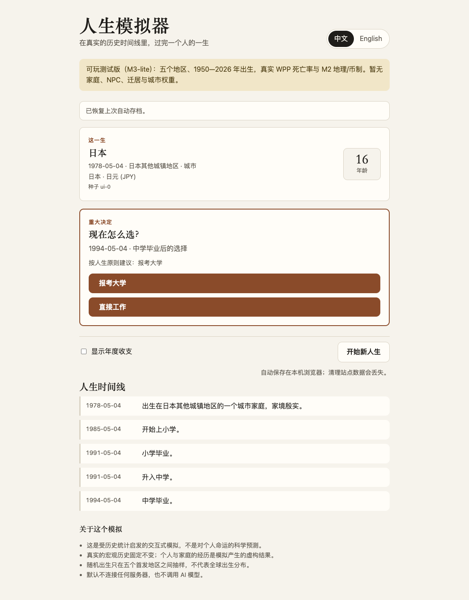
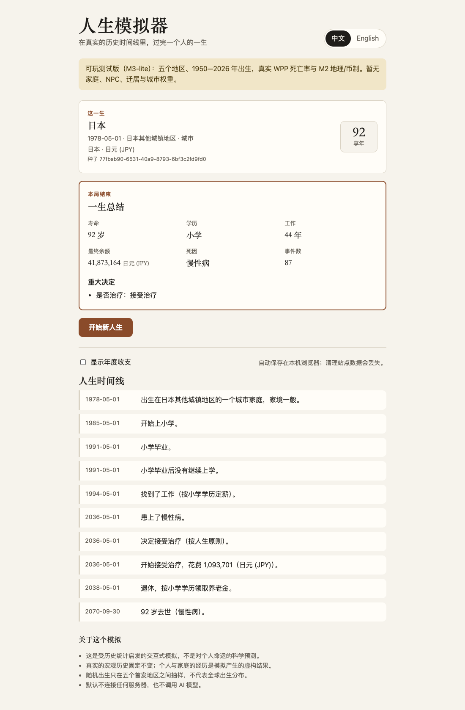

# 可玩测试版（M3-lite）

> 这是 LifeSim 的第一个**可游玩测试版本**，不是 v0.1 公开 Alpha。范围与限制由 [ADR-0006](adr/0006-first-playable-slice.md) 定义。

## 现在能做什么

- 在中国大陆、日本、朝鲜、韩国、俄罗斯（含苏联时期）之间选择或随机出生，年份 1950—2026。
- 出生时有父母两位家庭成员（只有初始状态：年龄与学历）；苏联解体时，在世的角色政治归属与国籍随之改变；地名、政体名与旗帜按当时的历史显示。
- 从出生跑到死亡：教育、求职/失业、年度收支、慢性病与治疗决定、退休、死亡与人生总结。
- 在中学毕业和是否治疗两个重大决定上亲自选择；也可以让程序按人生原则自动选完。
- 中文 / English 切换只重绘叙事，不重新模拟、不改变结构化事实。
- 自动保存在本机浏览器，刷新页面后继续这一局。

## 运行

    pnpm install
    pnpm dev

打开终端提示的本地地址（通常是 http://127.0.0.1:5173/）。

生产构建本地预览：

    pnpm build
    pnpm --filter @lifesim/web preview

无界面跑一局真实国家包人生：

    pnpm life:real --region JP --year 1978 --birth 1978-05-04
    pnpm life:real --region CN --year 1950 --locale en --all
    pnpm life:real --region random --year random --json

## 数据与规则边界

- 出生数、单岁生命表（男女合计）与城镇比例来自联合国 WPP 2024 与世界银行 WDI；生命表是 B 级数据，2100 年以后才用情景延伸。
- 地理、行政归属、政体、币制与重定值来自 M2 国家包。
- 教育、就业、工资/生活费、疾病发病与风险乘数是**D 级设计假设**（ADR-0006），不是五国历史统计；它们只用于让测试版可玩。M3-004…006 已经导入世界银行的教育、劳动力、CPI 与卫生数据，但规则还没有使用它们。
- 父母的生育年龄与学历是 D 级常数，不是统计。
- 事件叙事由与语言无关的事实 + 中英模板生成；数字、地点与币制名来自国家包。

## 已知限制

- **不能逐年经历人生**：点「开始人生」后会直接跳到下一个重大决定，有时一次出现几十年的事件；逐年推进、自动播放、暂停与调速见 [M3-034](tasks/M3-034.md)。
- 父母没有自己的人生进程：不会变老、退休或去世（M3-011）；时间线上父母的币制换算、政体更替事实和主角的写法相同，看不出是谁。
- 没有婚育、收养、迁居、城市人口权重或各国特色事件。
- 页面顶部的阶段说明仍写「暂无家庭、NPC」，已过时（M3-034 修正）。
- 网页在主线程同步推进（一局通常几十毫秒）；Worker、IndexedDB、PWA 离线与时间线虚拟化属于 M4。
- 自动存档是 localStorage；清理站点数据、换浏览器或隐私模式会丢失。存档导出/导入尚未实现。
- 2026 年以后的年份使用明确标注的预测或情景，不是真实历史。
- 首个构建会把五国数据一起打包，体积较大；后续会按需加载。
- 平衡数值是测试用占位，不是对任何国家生活水平或寿命的承诺。

## 反馈时请附上

- 角色卡里的种子（seed）与出生日期/地区；
- 语言、浏览器与是否刷新过；
- 如果出现错误，React 错误面板里的文字。

## 相关文档

- [ADR-0006](adr/0006-first-playable-slice.md)：可玩切片范围与 D 级规则。
- [ROADMAP](ROADMAP.md)：M3 / M4 剩余工作。
- [AGENT_HANDOFF](AGENT_HANDOFF.md)：仓库现状与验证命令。
